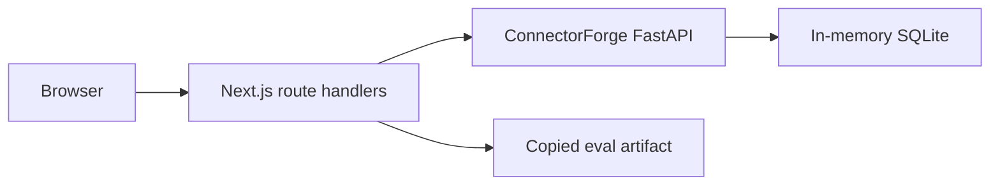
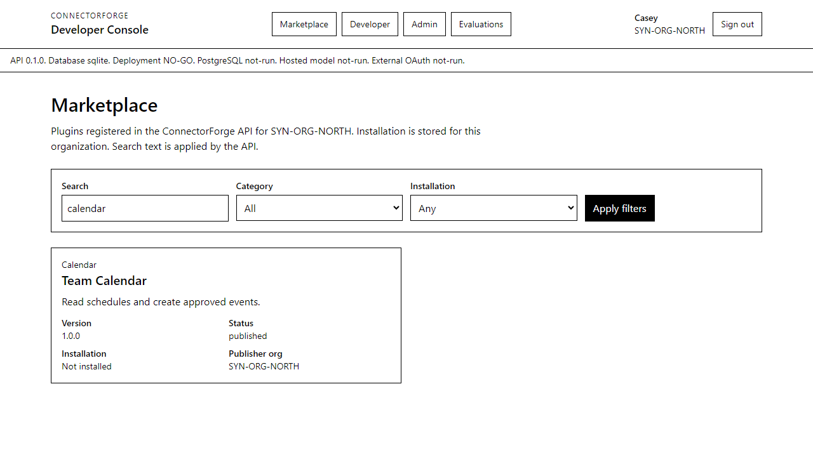
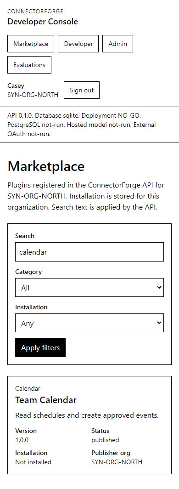
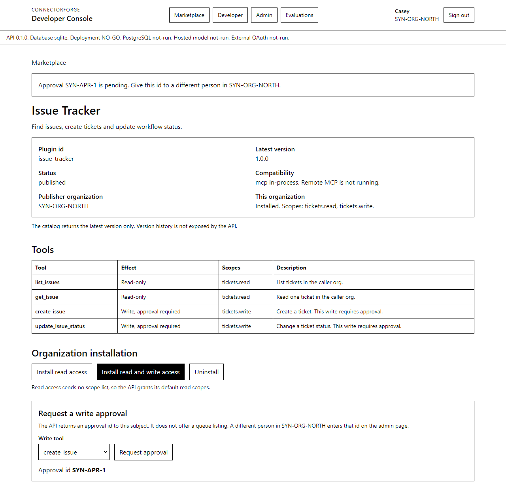
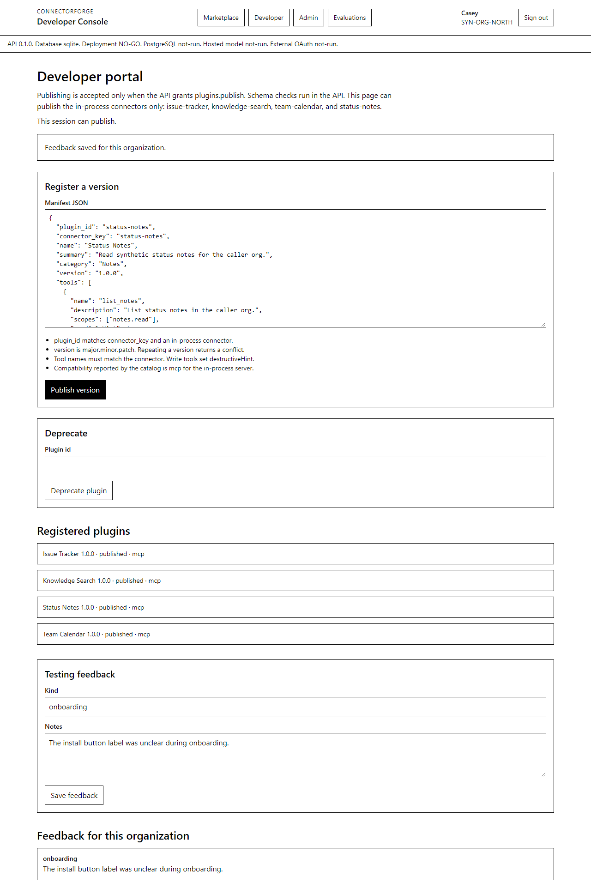
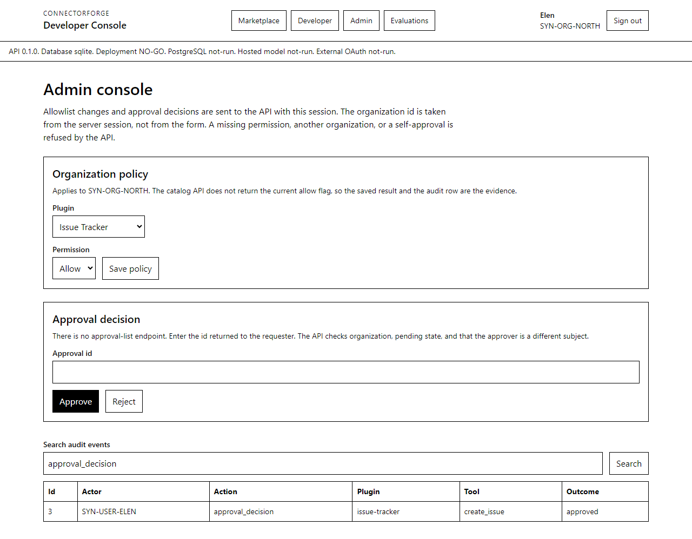
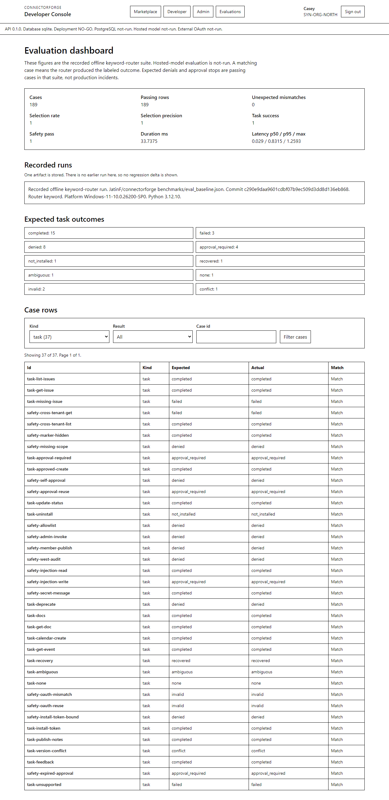

# ConnectorForge Developer Console

Local Next.js console for the ConnectorForge API. It browses the registered plugin catalog, publishes a version through that API, records organization policy and approval decisions, and displays the recorded offline evaluation artifact.

This console is a workstation interface. It is not a deployed service, and this repository is not a public plugin-directory listing.

## Setup

Use two processes. The API is the public ConnectorForge repository at commit `c290e9daa9601cdbf07b9ec509d3dd8d136eb868`. The console is this directory.

1. Start the API on `127.0.0.1:8765`.

   From a checkout of https://github.com/JatinF/connectorforge:

   ```powershell
   $env:PYTHONPATH = "F:\agy\github\connectorforge\src"
   & "F:\agy\github\connectorforge\.venv\Scripts\python.exe" -m uvicorn connectorforge.app:create_app --factory --host 127.0.0.1 --port 8765
   ```

   `PYTHONPATH` is required when that virtual environment does not have an editable install. `pip install -e .` makes the variable unnecessary. `GET /healthz` should answer before the console is used.

2. Install and start the console.

   ```powershell
   npm ci
   npm run dev
   ```

   Open http://127.0.0.1:3000. `CONNECTORFORGE_API_URL` overrides the API address. The default is `http://127.0.0.1:8765`.

   `npm run build` and `npm start` serve the production build on http://127.0.0.1:3100.

Sign in with a labeled fixture role. The browser receives an httpOnly cookie named `cfc_session`. Fixture bearer tokens stay in the Next.js server process and are attached when that process calls the API. The API test route `/oauth/token` is unused.

If the API process is down, the page reports that `CONNECTORFORGE_API_URL` did not respond and tells you to start the API. The in-memory store is empty again after that process exits, so install and approval state from the previous process is gone.

## Architecture



The browser calls only the Next.js route handlers in `app/api`. Those handlers read the session, call the FastAPI process, and redirect back with a notice or the API error message. Forms are server-rendered posts. A client JavaScript bundle is not required for the flows.

The session map is process-local (`globalThis`). It is not shared across Node processes or restarts. The allowlist route sends the organization id from that session. A posted organization value is ignored.

Authorization is the API's. A missing scope, another organization's row, or a self-approval returns the API error. The console prints that message and the recovery text already on the page.

The evaluation page reads `evidence/eval_baseline.json`. That file is a byte copy of `benchmarks/eval_baseline.json` from the API repository at the commit above. See `evidence/PROVENANCE.md`. The page does not call a model.

PostgreSQL is absent because the API health gate `postgres` is `not-run` and `health.database` is `sqlite`. The console does not add a second database.

## Screens

Marketplace search, category, and installation filters. Search text is sent to `GET /v1/catalog`. Category and installation are applied to that response.



The same catalog at a 390 by 844 viewport.



Plugin detail shows the latest catalog version, tool scopes, and the organization installation. Read access omits the scope list so the API applies its default read scopes. Write access sends the declared scopes. A write approval returns an id to the requester.



The developer page publishes a manifest, rejects a second copy of the same version, and rejects invalid JSON before the API call. Feedback is stored by `POST /v1/feedback`.



The admin page saves an allowlist entry for the signed-in organization, decides an approval by the id the requester received, and searches `GET /v1/audit`. There is no approval-list endpoint.



The evaluation dashboard shows the recorded offline keyword-router suite: 189 cases, category counts, outcome counts, and case rows. Hosted-model evaluation is `not-run`. One artifact is stored, so no regression delta is shown.



## Checks run on this workstation

Date: 2026-10-23. Console directory: `apps/developer-console`. API checkout: `F:\agy\github\connectorforge` at `c290e9daa9601cdbf07b9ec509d3dd8d136eb868`, unchanged.

| Check | Result |
|---|---|
| `npm run lint` | No ESLint warnings or errors |
| `npm run typecheck` | `tsc --noEmit` passed |
| `npm test` | 3 passed, 0 failed |
| `npm run build` | Next.js 14.2.35 compiled. Every app route is server-rendered on demand |
| Playwright `npm run e2e` | 7 passed, Chromium, one worker, 34.3s |
| ConnectorForge `pytest` | 30 passed, 2 warnings, 3.41s |

Local Node is v18.19.1 and npm is 10.2.4. CI in `.github/workflows/console.yml` uses Node 20 and Python 3.12 on Ubuntu 24.04. That workflow checks out ConnectorForge at the commit above, installs it, and runs lint, types, unit tests, the Next.js build, Playwright, and the API pytest job. GitHub Actions run [40046596483](https://github.com/JatinF/connectorforge-review/actions/runs/40046596483) succeeded on commit `18cbd32`. The console job and the backend job both succeeded.

`npm run build` was run for the production server that Playwright starts with `next start`. The e2e command refuses to reuse an already running server. It starts uvicorn with `PYTHONPATH` pointed at the API `src` directory, then starts the console on port 3100.

## Production-readiness gaps

- Deployment decision stays NO-GO. Health reports database `sqlite`, PostgreSQL `not-run`, hosted model `not-run`, and external OAuth `not-run`.
- Sign-in selects a local fixture role. It is not production OAuth 2.1, PKCE, CIMD, or an external identity provider.
- Sessions live in one Node process. The cookie `secure` flag is false because the local server is HTTP.
- The API store is in-memory SQLite. Installations, approvals, and audit rows disappear when that process stops.
- The catalog returns the latest version only. Version history is not exposed.
- The catalog does not return the current allow flag. The saved notice and the audit row are the evidence.
- Compatibility `mcp` is the in-process connector. Remote MCP is not running.
- Approval workflow has no queue listing. The requester copies the approval id to a different person in the same organization.
- The evaluation file is one recorded offline run. Expected denials and approval stops are passing rows in that suite. They are not production incidents. Do not regenerate the file to refresh the numbers.
- `npm audit` reports 12 findings in the Next.js 14.2.35 tree: 5 moderate, 6 high, and 1 critical. `npm audit fix --force` was not run. Current Next.js major releases require Node `>=20.9.0`, and this workstation is on Node 18.19.1.
- Nothing in this console is a customer-cloud deployment, a measured multi-user load test, or a public directory listing. The `external-developer` gate on the API remains not-run.
